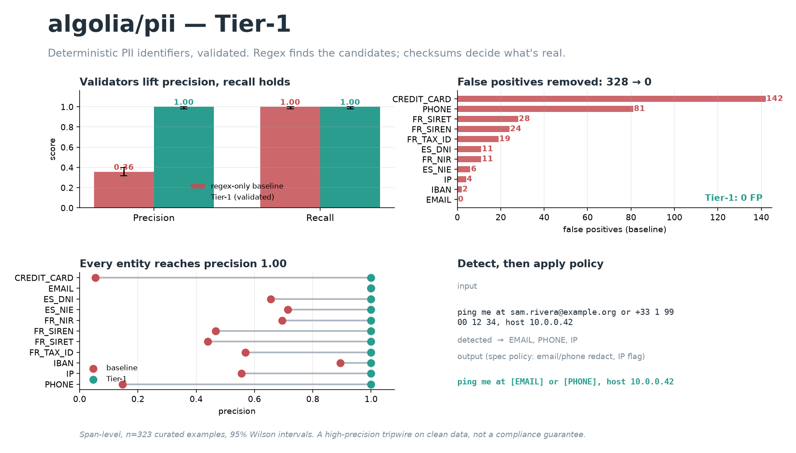

# algolia/pii-filter



<sub>Regenerate: `PYTHONPATH=src python -m pii.bench.cli hero`</sub>

**Structural-identifier detection and policy, in Go and Python.** One spec and
one labeled corpus, two native implementations: detect emails, phone numbers,
payment cards, IBANs, IPs and French/Spanish national identifiers in text, then
decide what to do with them (reject, redact, hash, flag). Every claim is
measured against a labeled corpus; every gap is documented (see
[Limitations](#limitations)). It is not a compliance guarantee — it is one layer
in the Swiss cheese — but it measurably reduces exposure. Detection answers
*what and where*; policy answers *what to do about it*.

## Limitations

Read this before depending on anything below.

- **Not a compliance guarantee.** This library reduces exposure; it does not
  certify a dataset PII-free. Describe what it does as detecting "structural
  identifiers", never as a "PII shield". The strongest control remains never
  ingesting personal data in the first place.
- **Tier-1 is structural only**: EMAIL, PHONE, CREDIT_CARD, IBAN, IP, and the
  French and Spanish national identifiers FR_NIR, FR_TAX_ID, FR_SIREN, FR_SIRET,
  ES_DNI, ES_NIE. Regex + checksum detection is a high-precision tripwire for
  identifiers — nothing more.
- **A valid checksum proves shape, not issuance.** A NIR, DNI or SIRET that
  passes its check may still be made up; nothing here looks a number up. The
  checks are weak by design of the numbers themselves: a random number of the
  right shape passes the NIR key 1 time in 100, the DNI/NIE letter 1 in 23, the
  numero fiscal check 1 in 1000, and Luhn 1 in 10.
- **Ungated national IDs flag lookalike numbers; earlier versions did not.** Before 0.2.0
  a bare 13- or 15-digit run was never flagged. Now, measured on 200,000 random
  strings each: FR_TAX_ID fires on about 0.09% of 13-digit millisecond
  timestamps and of French EAN-13 barcodes (prefix 30-37); FR_NIR fires on
  about 1.0% of 15-digit numbers starting 1, 2, 7 or 8 (the key's floor, the
  price of an ungated Tier-1 entity); ES_DNI fires on about 3.9% of "8 digits
  + uppercase letter" codes such as SKUs. `log_safe` and `block_if_detected`
  users upgrading will see new `[FR_TAX_ID]`, `[FR_NIR]` and `[ES_DNI]`
  redactions. The knobs: a policy map that drops an entity (`{"FR_TAX_ID":
  Policy.ALLOW}`, or `FLAG` to count without masking), or a keyword gate of your
  own downstream on the findings.
- **SIREN and SIRET need a keyword** (Tier 1.5). Luhn alone accepts one random
  9- or 14-digit number in ten, so these two only fire when a keyword such as
  `SIREN`, `SIRET`, `RCS` or `numéro d'entreprise` lies whole inside the 40
  characters before the number. A bare company number in prose is not detected.
  Some keywords are generic (`rcs`, `business id`, `company number`), so they
  open the gate in text that is not about French companies.
- **After a keyword, a Diners-shaped number is a SIRET.** A Luhn-valid 14-digit
  number starting 30, 36 or 38 within the window after a keyword is reported as
  FR_SIRET (default `redact`), not CREDIT_CARD (default `reject`). A caller that
  needs reject-on-card semantics must pass an explicit policy, e.g.
  `{"FR_SIRET": Policy.REJECT}`.
- **Known national-ID gaps.** A checksum-invalid NIR, numero fiscal or SIRET
  written in digit groups is still reported as PHONE by the phone
  heuristic. A Luhn-valid 14-digit SIRET starting 30, 36 or 38 with no keyword
  is a CREDIT_CARD (it is also a valid Diners number). DNI/NIE letters must be
  uppercase; the NIR month and department are not checked against the INSEE
  tables (so the corpus uses unissued months 14-19); overseas 3+2 place grouping
  has no special handling.
- **Same corpus is not full parity.** Python and Go agree on every corpus row,
  but they have known, pre-existing disagreements on CREDIT_CARD, PHONE and IP
  edge cases outside it (about 124 per 20,000 fuzz strings, measured before 0.2.0).
- **Tier-2 (PERSON, ADDRESS) is an interface with a no-op backend today.** NER
  is a best-effort guess wherever it lands; honest out-of-domain F1 for open
  models clusters near 0.5 ([`docs/research-sota-2026-07.md`](docs/research-sota-2026-07.md)).
- **GDPR Article 9 / health semantics are out of scope by design** — lexical-only
  and documented incomplete, never an inference model (the CJEU treats inferred
  Art. 9 data as Art. 9 data, so inference creates the liability it detects).
- **Corpus numbers are corpus numbers.** Precision 1.00 is a point estimate on
  323 curated examples, 182 labeled spans (overall CI floor 0.98, per new
  national-ID entity 0.80-0.87 on 15-25 spans each); field accuracy is
  unmeasured. The national-ID rows are synthetic, built
  by a seeded generator (`corpus/synth_ids.py`), not sampled from real text,
  and drawn from ranges meant to be unissued (its header says how strong each
  choice is).

## Recipes

Pick your surface. One posture rule throughout: **block on what's provable
(Tier-1 structural), only observe everything else.** Each recipe names the
constraint it addresses.

### Log-safe telemetry (Python)

*Addresses: raw user text must not land in analytics, dashboards, or logs.*

Typed masks instead of values — `[EMAIL] called from [PHONE]` — from one call that
redacts every Tier-1 identifier and never raises, so the logging path can't throw:

```python
from pii import log_safe

logger.info("user query: %s", log_safe(query))
```

Pass `policy=` to hash instead of redact (same shapes `apply_policy` takes), e.g.
`log_safe(query, policy={"EMAIL": Policy.HASH})`. Any REJECT downgrades to REDACT here
— masking is the job, dropping the line is not. It masks *structural identifiers only*
(see [Limitations](#limitations)); it does not remove names, addresses, or PII at large.

Under the hood it is the recipe you'd otherwise write by hand:
`apply_policy(text, Tier1Detector().detect(text), lambda entity: Policy.REDACT)`.

### Pre-LLM gate (Python)

*Addresses: card data must not be collected; structural identifiers should be
stripped or rejected before anything leaves for a third-party LLM provider.*

One call, spec defaults: reject cards and IBANs (raising `Rejected`), redact
contact details, flag IPs. Raising is the feature — it refuses the text so the
caller can't forward it:

```python
from pii import Rejected, block_if_detected

try:
    prompt = block_if_detected(user_input)  # returns treated text, or raises
except Rejected as exc:
    refuse(f"request contains {exc.entity}")  # never forward it
```

Pass `policy=` for a stricter or laxer posture (same shapes `apply_policy` takes),
e.g. `block_if_detected(prompt, policy={"EMAIL": Policy.REJECT})`. Unlike
`log_safe`, `block_if_detected` never coerces non-string input (that would be a
hole) and never swallows the `Rejected` — a gate that lets card data through is
not a gate.

Under the hood it is the recipe you'd otherwise write by hand:
`apply_policy(prompt, Tier1Detector().detect(prompt), spec_policy())`.

Honesty note: this gates *structural identifiers*. It does not detect health
semantics or names (see [Limitations](#limitations)) — a health-data posture
needs this gate **plus** routing/scoping decisions, not this gate alone.

### Ingestion-time policy (Go)

*Addresses: records must be treated before they're written to an index; cards
are rejected outright.*

```go
import "github.com/algolia/pii-filter"

func scrub(record string) (string, error) {
    findings := pii.DefaultAnalyzer().Analyze(record)
    clean, err := pii.SpecPolicy().Apply(record, findings)
    if err == pii.ErrRejected {
        return "", err // drop the record + alert
    }
    return clean, err
}
```

The shape is a config-driven policy step in the ingestion worker, upstream of
the index write.

### Training-data anonymization (Python)

*Addresses: raw identifier values must not survive into derived datasets.*

`hash` keeps join-ability without the raw value; `redact` for entities you'd
rather lose than keep in any form:

```python
from pii import Policy, Tier1Detector, apply_policy

TRAINING_POLICY = {
    "EMAIL": Policy.HASH,
    "PHONE": Policy.HASH,
    "IP": Policy.HASH,
    "CREDIT_CARD": Policy.REDACT,
    "IBAN": Policy.REDACT,
}

findings = Tier1Detector().detect(sample)
derived = apply_policy(sample, findings, TRAINING_POLICY)
```

## Why it is shaped this way

Two runtimes: ingestion pipelines in **Go** and inference-time services in
**Python**. Go and Python cannot share a library, so we share a **spec + a golden corpus** instead and write two native
implementations. The corpus is the contract: the spec regexes use lookbehind,
which Go's RE2 cannot express, so the Go detectors reproduce the *behavior*, and
both sides are held to the same labeled spans.

```
spec/entities.yaml  (SSOT: entities, regexes, validators, default policies)
corpus/*.jsonl      (golden, span-labeled  <- the cross-language contract)
        |                                   |
   Go (this repo root)               Python (src/pii)
   pii.go / detectors.go             detect.py / validators.py
   corpus_test.go  ──────tested against the same corpus──────  tests/test_corpus.py
```

## Two tiers of detection

- **Tier 1 — deterministic** (ships here, in both languages): regex +
  checksum/structure validation, in-process, fast, high precision. Grounded in
  [`docs/research-deterministic-validators.md`](docs/research-deterministic-validators.md).
  **Tier 1.5** entities are Tier 1 plus a keyword gate: the number only counts
  when a context keyword precedes it (see [`SPEC.md`](SPEC.md)).

  | Entity | What | Validation | Default policy |
  |---|---|---|---|
  | EMAIL | email address | regex | redact |
  | PHONE | phone number | digit count, not an IP or date | redact |
  | CREDIT_CARD | payment card | Luhn + IIN + length | reject |
  | IBAN | bank account | per-country length + mod-97 | reject |
  | IP | IPv4 address | octet range | flag |
  | FR_NIR | French social security number (15 chars) | mod-97 key, Corsica 2A/2B; ~1% of random 15-digit runs starting 1/2/7/8 pass | redact |
  | FR_TAX_ID | French numero fiscal / SPI (13 digits) | first digit 0-3, mod 511; ~0.09% of ms timestamps and EAN-13 pass | redact |
  | FR_SIREN | French company number (9 digits) | Luhn + keyword gate (1.5) | redact |
  | FR_SIRET | French establishment number (14 digits) | Luhn on the SIREN and on all 14 digits (La Poste: Luhn or digit sum) + keyword gate (1.5) | redact |
  | ES_DNI | Spanish national ID (8 digits + letter) | mod-23 letter; ~3.9% of "8 digits + capital" codes pass | redact |
  | ES_NIE | Spanish foreigner ID (X/Y/Z + 7 digits + letter) | mod-23 letter | redact |

  Redaction writes the typed mask (`[FR_NIR]`, `[ES_DNI]`, …).
- **Tier 2 — probabilistic** (interface only, not yet model-backed):
  PERSON, ADDRESS, free-text and special-category PII via NER. Python owns the ML
  ecosystem; Go reaches an equivalent backend over a sidecar / ONNX / cloud DLP.
  See [`tier2.go`](tier2.go), [`src/pii/tier2.py`](src/pii/tier2.py),
  [`docs/research-python-pii-sota.md`](docs/research-python-pii-sota.md),
  [`docs/research-go-pii-landscape.md`](docs/research-go-pii-landscape.md).

## The validators earn their keep (calibrated evidence)

Span-level scores over the 323-example corpus (182 labeled spans), regex-only
baseline vs validated Tier-1 (95% Wilson intervals, because n is small and
honesty is the point):

| Detector | Precision | Recall | False positives |
|---|---|---|---|
| regex-only baseline | 0.36 [0.32-0.40] | 1.00 [0.98-1.00] | 328 |
| **Tier-1 (validated)** | **1.00 [0.98-1.00]** | **1.00 [0.98-1.00]** | **0** |

The baseline over-matches (Luhn/IIN-invalid cards, out-of-range IPs, invalid
IBANs, date-like phone numbers, checksum-invalid and keyword-less national
IDs); the validators and the keyword gate remove every false positive without
costing recall. The baseline's false-positive count reflects how many near
misses the corpus holds (most of the 0.2.0 rows are deliberate near misses), so
compare it across detectors, not across corpus versions. Charts: [`docs/bench-tier1.png`](docs/bench-tier1.png)
vs [`docs/bench-baseline.png`](docs/bench-baseline.png). Reproduce:

```bash
PYTHONPATH=src python -m pii.bench.cli compare
```

The point estimate is 1.00 on this curated set; the CI floor is ~0.89. This is a
tripwire demonstrated on a small, clean corpus, not a claim of field accuracy.

## Policy (the anonymizer half)

Detection is separate from policy. Actions: `reject` (drop the record + alert —
the safe default for a public index), `redact` (typed mask), `hash` (stable, for
joins), `tokenize` (placeholder; reversible needs a vault), `flag` (report only),
`allow` (explicit allowlist). Spec per-entity defaults: cards/IBANs **reject**,
email/phone and the national identifiers **redact**, IP **flag**. A pre-LLM gate
that must refuse national IDs instead passes
`policy={"FR_NIR": Policy.REJECT, …}`.

## API

**Go (Tier-1, in-process):**

```go
import "github.com/algolia/pii-filter"

findings := pii.DefaultAnalyzer().Analyze(text)
clean, err := pii.SpecPolicy().Apply(text, findings) // err == pii.ErrRejected => drop the record
```

**Python:**

```python
from pii import Tier1Detector, apply_policy, spec_policy

findings = Tier1Detector().detect(text)
clean = apply_policy(text, findings, spec_policy())  # raises Rejected to drop
```

Full surface: `Finding` (entity, span, value, score, tier), `Policy` (the six
actions), `Tier2Backend`/`NullTier2` (the probabilistic seam), `load_entities`
(spec access). Depending on it from another project (pip/`go get`, the
Tier-1/Tier-2 boundary): see
[`docs/integration.md`](docs/integration.md).

## Repo layout

```
SPEC.md                 design RFC
spec/entities.yaml      SSOT: entities, regexes, validators, default policies
spec/schema/*.json      Finding + Policy + entity-spec JSON schemas
corpus/*.jsonl          golden, span-labeled corpus (the contract)
corpus/build_corpus.py  corpus generator; synth_ids.py builds the national IDs
pii.go detectors.go     Go implementation (module github.com/algolia/pii-filter)
identifiers.go          Go: FR/ES national identifiers; context.go: keyword gate
policy.go tier2.go
corpus_test.go          Go: scored against corpus/*.jsonl
src/pii/                Python package (detect, validators, anonymize, tier2, spec)
src/pii/bench/          calibrated harness (corpus, score+Wilson CIs, report, cli)
tests/                  Python tests
docs/                   integration guide, research outputs, bibliography, bench charts
```

## Develop

```bash
go test ./...                                   # Go (root module)
poetry install --extras bench && poetry run pytest tests/ -q   # Python
poetry run pii-bench compare                    # regenerate the bench + charts (needs the bench extra)
python3 corpus/build_corpus.py                  # regenerate the corpus (seeded, reproducible)
```

## Status

**v0.2.0** adds the French and Spanish national identifiers (FR_NIR, FR_TAX_ID,
keyword-gated FR_SIREN/FR_SIRET, ES_DNI, ES_NIE) in Go + Python, and moves
matplotlib out of the core install into the `bench` extra. Tier-1 in Go +
Python, shared spec + corpus, calibrated bench, `go get` and `pip install` both
work ([`docs/integration.md`](docs/integration.md)); see
[`CHANGELOG.md`](CHANGELOG.md). Tier-2 (PERSON / ADDRESS) is an interface with a
no-op backend; GDPR Article 9 special categories stay out of scope (see
[Limitations](#limitations)).
