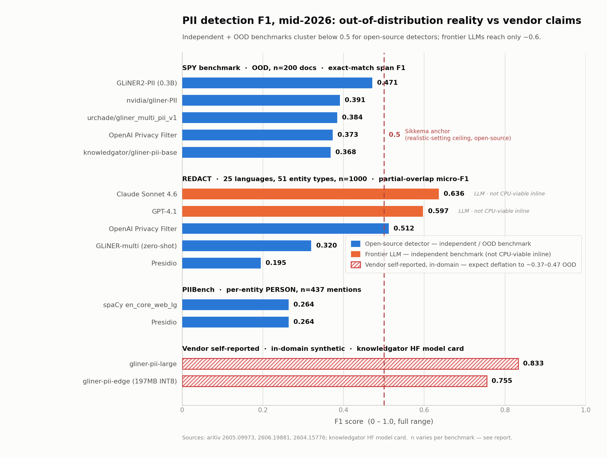
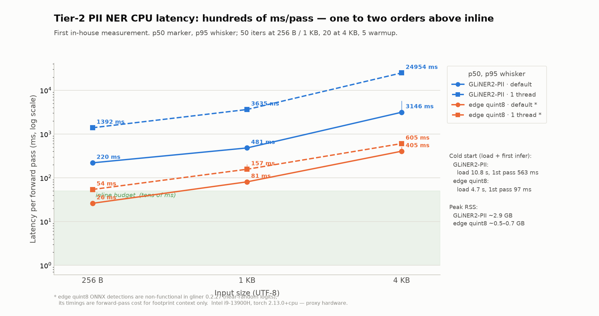
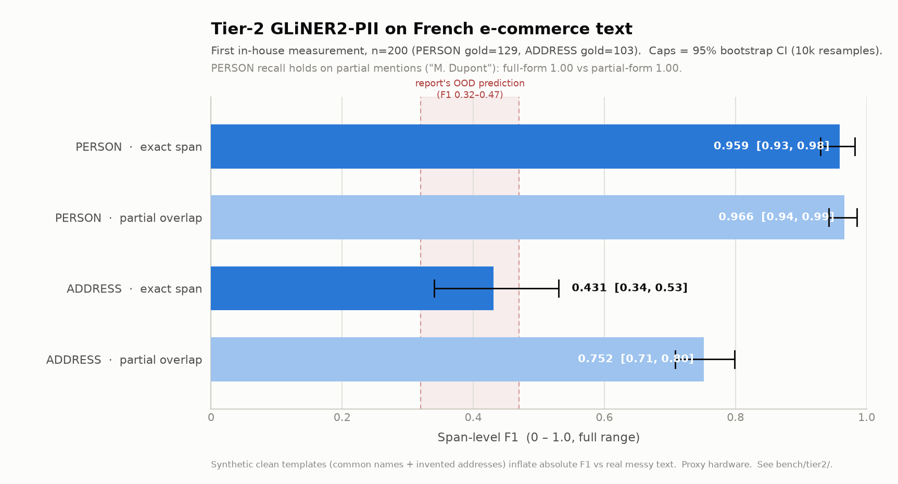

# PII detection: state of the art, mid-2026

Literature review, 2026-07-15: 18 sources; the 25 most important claims were checked
against their primary sources, and 24 held. Scope: Python-first, CPU-only,
French/multilingual, PERSON + ADDRESS (Tier-2), with an inline latency budget of tens of
milliseconds.

## Executive summary

The realistic-setting accuracy anchor (Sikkema, 2026-06: open-source PII NER ~F1 0.5) is
**confirmed and even undercut** on out-of-distribution benchmarks: the best open detectors
(GLiNER family) reach F1 0.32–0.47, Presidio 0.14–0.20 with near-zero recall on ADDRESS
and high-sensitivity entities, and even frontier LLMs top out around 0.6–0.64 — all far
below marketed numbers. On latency, **no published source reports CPU NER latency per KB
at all**, so the inline-budget question has to be measured directly (see First
measurements below). The only CPU datum
in the GLiNER lineage is 130–208 ms for *classification*, already past a tens-of-ms inline
budget. The one code-verified practitioner deployment
(tamga) runs only Aho-Corasick/regex inline (<2 ms) and pushes all NER/LLM analysis to an
async lane.

**Recommendation for this toolkit:** keep Tier-1 structural inline (clearly feasible);
do NOT build Tier-2 semantic inline — nothing clears the bar today. Run GLiNER2-PII
(0.3B) or knowledgator gliner-pii-edge (197 MB INT8 ONNX) **asynchronously, off the
request path**, measure CPU latency directly (the datum missing everywhere), and expect
F1 ≈ 0.4–0.5 on PERSON, materially worse on ADDRESS.

## The honest accuracy picture

| Benchmark | Setting | Best result | Notes |
|---|---|---|---|
| SPY (arXiv 2605.09973, Table 2) | OOD, n=200 docs, exact-match span F1 | GLiNER2-PII **0.471**; nvidia/gliner-PII 0.391; urchade gliner_multi_pii_v1 0.384; OpenAI Privacy Filter 0.373; knowledgator base 0.368 | Vendor-authored eval (Fastino), but below-0.5 clustering runs *against* marketing interest. ai4privacy/pii-masking-300k excluded for train/eval overlap. |
| REDACT (ServiceNow, arXiv 2606.19881, Table 1) | 25 languages, 51 entity types, locked n=1,000, partial-overlap micro-F1 | Claude Sonnet 4.6 0.636; GPT-4.1 0.597; OpenAI Privacy Filter 0.512; GLiNER-multi **0.320**; Presidio **0.195** | Fully synthetic corpus (authors admit validity unquantified). 51-type schema structurally penalizes narrow-schema detectors — Presidio's number partly coverage mismatch. |
| PIIBench (arXiv 2604.15776, Tables 4–6) | Per-entity, n=437 PERSON / 91 ADDRESS mentions | PERSON: Presidio 0.264, spaCy lg 0.264. ADDRESS: **0.000** both | Single-author preprint, synthetic-heavy; ADDRESS zero partly a label-mapping artifact (city/state/zip → LOC scores ~0.31). Confidence: medium. |
| knowledgator model card (HF, fetched 2026-07-15) | Vendor in-domain synthetic, self-reported | gliner-pii-large 0.833; gliner-pii-edge 0.755 | No train/eval independence stated; edge does not beat 2024's urchade multi_pii-v1 (0.769) on the vendor's own table. Expect deflation toward 0.37–0.47 OOD. |

**Failure-slice warning (REDACT §5.2):** Presidio-class regex+NER hybrids
invert on what matters — recall 0.23 on LOW-sensitivity entities drops to **0.07 on
HIGH-sensitivity** (GDPR Art. 9-tier), while LLM detectors peak there (Claude 0.77). On
non-verbatim mentions: 0.02 recall on partial disclosures ("J. Smith"), 0.07 on
obfuscated, vs 0.23 fully-spelled. Aggregate F1 masks exactly these slices. Directly
relevant to why this toolkit's health-entity scope-out (SPEC) remains correct.

## Tier-2 candidates (CPU axis)

| Candidate | Size / footprint | Entities | Languages | License / packaging | CPU latency | Verdict |
|---|---|---|---|---|---|---|
| **GLiNER2-PII** (Fastino, arXiv 2605.09973; HF `fastino/gliner2-privacy-filter-PII-multi`) | 0.3B params | 42 PII types incl. person, full_name, address, street_address, city, postal_code | Multilingual, **French explicitly in training mix** | Apache-2.0 lineage; `gliner2` on PyPI (v1.3.2, `[local]` extra for CPU) | **Not reported** — deferred to future work | Best candidate on paper; French PERSON/ADDRESS accuracy unverified; 100% synthetic training (n=4,910) |
| **knowledgator gliner-pii-edge-v1.0** (HF card) | 330 MB FP16 / **197 MB UINT8 ONNX** | PII-tuned GLiNER | Multilingual (unverified per-language) | Model card; ONNX → portable, plausible Go story via ONNX runtime | **Not reported** (only generic gline-rs Rust runtime speed claims) | Most deployment-ready artifact; accuracy self-reported in-domain only |
| **GLiNER Guard** (HiveTraceLab, arXiv May 2026) | 145–209M, safety+PII in ONE forward pass | Name 0.757 / Address 0.687 (own bench) | **Russian-only synthetic eval** | Preprint + weights | A100-only figures (0.019 s/req); authors warn CPU may not generalize | Architecturally interesting: one forward pass serves both safety classification and PII. Untested here |
| GLiNER2 base lib (EMNLP 2025 demos) | 205M encoder, 2048-token ctx | Zero-shot NER | Multilingual | Apache 2.0, pip | 130–208 ms CPU — but for *classification*, input length unspecified | The only CPU number in the whole lineage, and it already busts a tens-of-ms budget |
| Presidio + spaCy/Stanza | Light | Narrow recognizer set | French via spaCy models | MIT, mature packaging | Fast-ish (unmeasured per KB) | Accuracy floor too low where it matters (see failure slices). Not a Tier-2 answer |

Commercial APIs (AWS Comprehend, GCP DLP, Azure PII, Private AI, Nightfall): landscape
noted, not evaluated in depth — sending customer text to a third party to *detect* PII
creates the transfer it polices; self-hosted detection avoids it.

## Deployment pattern (verified at code level)

The one purpose-built LLM security proxy examined (tamga, v0.7.0, repo cloned) implements
exactly the two-tier split this toolkit hypothesizes: synchronous Aho-Corasick DFA + regex
on the request path (p95 0.52 ms, total proxy overhead <2 ms), with Presidio NER and
LLM-as-judge pushed to an async gRPC lane whose findings are **only logged, never gating**.
NER is not run inline even in a purpose-built security proxy. (Confidence: medium — single
small repo; a code-verified existence proof of the pattern, not an industry norm. Its
self-reported ~48% deterministic-only recall was REFUTED 1-2 in verification, so the size
of the gap Tier-2 would close is unquantified.)

## Implications for this toolkit

1. **Tier-1 (structural, inline)** — unchanged, validated: deterministic matching at
   sub-ms/KB is the only thing proven inline-viable anywhere.
2. **Tier-2 (PERSON/ADDRESS)** — only asynchronously, off the request path; nothing
   should block on it. **GLiNER2-PII** is the accuracy-lean candidate, gliner-pii-edge
   INT8 the footprint-lean one. It is not a "PII shield".
3. **Two missing measurements**: (a) CPU latency and memory per ~1 KB — no published
   source has it. (b) A small French/e-commerce eval set (n≈200, bootstrap CIs) — every
   published benchmark is synthetic and none covers search-query-shaped text. Both are
   in First measurements below.
4. **Watch**: GLiNER-Guard-style single-pass safety+PII models; a Russian-only synthetic
   eval makes it a watch item.

## Open questions

1. CPU latency/memory per KB for GLiNER2-PII and gliner-pii-edge on server hardware (the
   numbers below come from a laptop).
2. French + realistic-domain PERSON/ADDRESS accuracy (a dedicated eval set is needed).
   Concrete build plan:
   - Synthesize mentions: common French first names (INSEE *fichier des prénoms*,
     aggregate counts) and common surnames for PERSON; invented street names, house
     numbers and communes for ADDRESS, so no real address appears. Combine into
     search-query-shaped and support-message-shaped texts.
   - Use existing open PII datasets (e.g. ai4privacy pii-masking-300k) only as a sanity
     check, never a gate — they carry documented train/eval overlap with most open
     detectors (see SPY's exclusion rationale).
   - Preferred mechanics: vendor a small deterministic generator script in this repo (not
     raw data dumps); target n≈200 hand-verified samples, report with bootstrap CIs.
3. Can PII detection share the forward pass of a safety classifier?
4. What recall does Tier-1 alone achieve on realistic inputs (the no-op's true gap)?

## Caveats

All four key papers are 2026 preprints, none peer-reviewed, in a fast-moving field (two
are <3 months old). Every benchmark cited is synthetic or partly synthetic; the two most
favorable numbers are vendor-self-reported on evals the same authors control. No benchmark
covers French PERSON/ADDRESS or search/e-commerce-shaped text, the domain measured below; domain
shift could move numbers either direction. Deployment-pattern evidence rests on one small
repo. Where aggregate F1 is quoted for Presidio/spaCy it is deflated by taxonomy mismatch;
per-entity numbers (PERSON ≈ 0.26) are the fairer — still poor — read.

## First measurements (2026-07-15)

The two missing measurements above, reproducible from `bench/tier2/` (code,
deterministic dataset generator, n=200 labeled set, raw results). Hardware: Intel
i9-13900H (20 threads), 64 GB RAM, torch 2.13.0+cpu — a laptop, not server hardware;
treat these as first numbers, not final.

**CPU latency + memory** (p50 per pass; 50 iters at 256 B / 1 KB, 20 at 4 KB, 5 warmup):

| Model | 256 B | 1 KB | 4 KB | 1 KB, 1 thread | Cold start | Peak RSS |
|---|---|---|---|---|---|---|
| GLiNER2-PII (0.3B) | 220 ms | **481 ms** | 3.1 s | **3.6 s** | load ~11 s + 563 ms first pass | ~2.9 GB |
| gliner-pii-edge quint8 ONNX (46 MB) | 26 ms | **81 ms** | 405 ms | 157 ms | load ~5 s + 97 ms first pass | ~0.5–0.7 GB |

The open question closes hard: GLiNER2-PII costs ~0.5 s/KB with all 20 threads and
~3.6 s/KB single-threaded (the figure when cores are shared) — one to two orders of magnitude
above a tens-of-ms inline budget. Even the edge model's 81–157 ms/KB busts it. **Inline
Tier-2 is not plausible on this hardware; only asynchronous use fits.** Two
corrections to the table above: the edge UINT8 artifact is ~46 MB (not 197 MB), and it is
currently **non-functional for detection**: its brand-new ettin/ModernBERT encoder returns
near-random logits in `gliner==0.2.27` — the vendor's own model-card example yields zero
entities across the PyTorch and ONNX paths (fp16 fails to load outright). Its latency is
reported for footprint context only; re-test when the gliner runtime catches up.

**French e-commerce mini-eval** (n=200, fully synthetic: common first names from INSEE
aggregate counts paired at random with a common-surname list, invented addresses whose
communes are not in the official commune list; search-query and support-message shapes,
25% negatives, 40% of PERSON mentions partial like "M. Dupont"; 95% bootstrap CIs, 10k
resamples; threshold 0.5):

| Entity (GLiNER2-PII) | Exact-span F1 | Partial-overlap F1 |
|---|---|---|
| PERSON (129 gold) | **0.959** [0.930, 0.982] | 0.966 [0.942, 0.986] |
| ADDRESS (103 gold) | **0.431** [0.340, 0.530] | 0.752 [0.708, 0.799] |

An earlier version of this set used different address strings; names and templates are
identical across versions, so the two runs are paired. The move (ADDRESS exact 0.385 to 0.431, partial 0.720 to 0.752, PERSON
0.955 to 0.959) is not significant: McNemar on the 30 discordant ADDRESS exact matches
gives p = 0.59, and the paired-bootstrap F1 delta CI spans zero [-0.06, +0.15].

Honest read: PERSON lands far above the OOD 0.32–0.47 prediction — clean templated text
flatters the model, and French full names are clearly in its training strength; notably
the predicted partial-mention collapse did **not** appear (recall 1.00 on "M. Dupont"
forms and on full names, n=50/79). ADDRESS exact-span lands **inside** the OOD band
(0.431) but the exact/partial gap shows the failure is boundary placement, not detection:
the model finds the address region (partial 0.75) and fumbles its exact extent. So the
report's ranking holds (ADDRESS weakest everywhere), while absolute numbers here are
optimistic — real user text is messier than templates. Verdict unchanged and now
evidenced: GLiNER2-PII run asynchronously is usable for PERSON today, needs
boundary-tolerant matching or span post-processing for ADDRESS, and the edge model is
not a candidate until its runtime works.

## Sources

Primary: arXiv 2605.09973 (GLiNER2-PII, Fastino, 2026-05); arXiv 2606.19881 (REDACT,
ServiceNow, 2026-06); arXiv 2604.15776 (PIIBench, 2026-04); GLiNER Guard (HiveTraceLab,
arXiv, 2026-05); GLiNER2 (EMNLP 2025 demos); huggingface.co/knowledgator/gliner-pii-edge-v1.0;
github.com/yatuk/tamga; presidio.dataprivacystack.org. Secondary/blog:
albertsikkema.com (2026-06-01 benchmark), pii.engineer, truefoundry.com, arthur.ai,
grepture.com.
